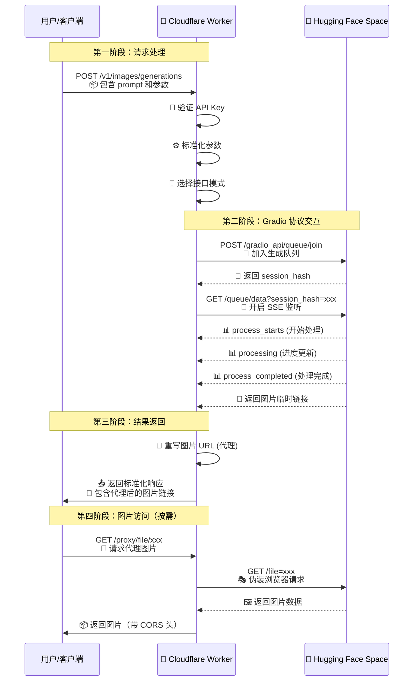

# 🎭 NSFW-Real-2API (奇美拉合成 - CloudFlare Worker 版)


> **"将复杂留给代码，将简单还给人类。"**  
> 这是一个关于连接、自由与技术民主化的实验，让任何人只需一次点击即可享用高质量的 AI 绘画 API。

**GitHub 仓库:** [https://github.com/lza6/nsfw-real-2api-cfwork/](https://github.com/lza6/nsfw-real-2api-cfwork/)

---

## 📖 目录

- [🌟 项目愿景与哲学](#-项目愿景与哲学)
- [✨ 核心功能亮点](#-核心功能亮点)
- [🏗️ 系统架构图](#️-系统架构图)
- [🔧 技术栈与原理](#-技术栈与原理)
- [🚀 快速部署指南](#-快速部署指南)
- [🎮 API 使用指南](#-api-使用指南)
- [📊 性能与特点分析](#-性能与特点分析)
- [🔄 未来路线图](#-未来路线图)
- [📚 开发者参考](#-开发者参考)
- [📄 许可证](#-许可证)

---

## 🌟 项目愿景与哲学

在这个 AI 技术爆发的时代，技术的壁垒往往不是算法本身，而是**接口的标准化**。

- **🎨 民主化 (Democratization):**  
  无论后端运行在昂贵的 H100 集群上，还是免费的 Hugging Face Space 上，用户都应该能用统一的方式（OpenAI 协议）访问它。
  
- **⚡ 极简主义 (Minimalism):**  
  拒绝臃肿的 Docker，拒绝复杂的 Python 环境。一个 JavaScript 文件，部署在全球最快的边缘网络（Cloudflare）上，这就是全部。

- **🔗 连接性 (Connection):**  
  项目代号 **"Chimera Synthesis" (奇美拉合成)**，寓意将不同的协议实体（Gradio 的 WebSocket/SSE 与 OpenAI 的 RESTful）融合为一个有机生命体。

**你来你也行！** 阅读本文档，你不仅能获得一个免费的 API，更能理解 HTTP 协议、流式传输和边缘计算的美妙。

---

## ✨ 核心功能亮点

### 🌉 协议彩虹桥
- **Gradio 到 OpenAI API 的完美转换**
- 自动处理复杂的 Gradio 队列系统和 SSE 流式通信
- 将异步队列状态机封装成简单的同步 HTTP 请求

### 🛡️ 图片隐身斗篷
- **智能图片代理系统**
- 自动重写 HF Space 临时链接
- 彻底解决跨域和防盗链问题
- 支持所有第三方客户端直接显示图片

### 🎛️ 参数全映射
- **完整的参数透传支持**
- ✅ 正向提示词 (Prompt)
- ✅ 负向提示词 (Negative Prompt)  
- ✅ 尺寸设置 (Width/Height)
- ✅ 迭代步数 (Steps)
- ✅ 引导系数 (Guidance Scale)
- ✅ 随机种子 (Seed)

### 🧠 双模接口驱动
- **`/v1/chat/completions`** - 聊天接口模式
  - 返回 Markdown 格式的图片
  - 适配 Cherry Studio、NextChat 等聊天客户端
  - 支持流式输出

- **`/v1/images/generations`** - 图像生成接口
  - 标准 DALL-E 3 兼容格式
  - 适配专业绘图客户端
  - 支持尺寸、步数等高级参数

### ⚡ 边缘极速响应
- **基于 Cloudflare Workers 的无服务器架构**
- 全球 300+ 边缘节点
- 毫秒级启动时间
- 每天 100,000 次免费请求

### 🖥️ 内置开发者驾驶舱
- **一站式 Web UI 控制台**
- 实时参数调整和预览
- 一键复制 API 端点
- 详细的请求日志
- 无需任何额外工具

---

## 🏗️ 系统架构图

```mermaid
graph TB
    subgraph "客户端层"
        A[🎨 绘图客户端] -->|OpenAI 协议| W
        B[💬 聊天客户端] -->|Chat Completions| W
        C[🌐 浏览器] -->|访问 Web UI| W
    end
    
    subgraph "边缘计算层 (Cloudflare Worker)"
        W[🚀 NSFW-Real-2API Worker]
        
        subgraph "协议转换引擎"
            P1[🎯 请求路由]
            P2[🔄 Gradio 客户端]
            P3[🖼️ 图片代理]
        end
        
        subgraph "数据处理流"
            D1[📦 接收请求]
            D2[🔐 身份验证]
            D3[⚙️ 参数标准化]
            D4[📡 SSE 流处理]
            D5[🔄 URL 重写]
            D6[📤 返回结果]
        end
        
        P1 --> P2
        P2 --> P3
        D1 --> D2 --> D3 --> D4 --> D5 --> D6
    end
    
    subgraph "上游服务层"
        H[🤗 Hugging Face Space]
        subgraph "Gradio 应用"
            G1[🎪 队列系统]
            G2[🎨 模型推理]
            G3[💾 临时存储]
        end
    end
    
    W -->|1. POST /queue/join| H
    H -->|2. 返回 session_hash| W
    W -->|3. GET /queue/data (SSE)| H
    H -->|4. 处理状态更新| W
    H -->|5. 处理完成| W
    
    style W fill:#ff6b6b,stroke:#333,stroke-width:2px
    style H fill:#4ecdc4,stroke:#333,stroke-width:2px
    style A fill:#ffd166,stroke:#333
    style B fill:#06d6a0,stroke:#333
    style C fill:#118ab2,stroke:#333
    
    click W "https://developers.cloudflare.com/workers/" "Cloudflare Workers 文档"
    click H "https://huggingface.co/spaces" "Hugging Face Spaces"
```

### 🔄 数据流程图



---

## 🔧 技术栈与原理

### 🛠️ 核心技术组件

| 组件 | 作用 | 难度 | 实现原理 |
|------|------|------|----------|
| **ReadableStream** | 流式数据传输 | ⭐⭐⭐⭐⭐ | 使用流式 API 边接收边处理，避免内存溢出 |
| **Server-Sent Events (SSE)** | 服务器推送事件 | ⭐⭐⭐⭐ | 解析 Gradio 的事件流，实时获取生成状态 |
| **TextDecoder** | 二进制数据解码 | ⭐⭐⭐ | 将网络传输的二进制流转换为可读文本 |
| **CORS Headers** | 跨域资源共享 | ⭐⭐ | 添加 `Access-Control-Allow-Origin: *` 头 |
| **Proxy Pattern** | 代理模式 | ⭐⭐⭐ | 中间层转发，解决跨域和防盗链问题 |
| **URL Rewriting** | URL 重写 | ⭐⭐⭐ | 将 HF 临时链接转换为 Worker 代理链接 |

### 🎯 关键代码结构

```javascript
// 核心架构 - 三层次设计
1. 🎪 路由层 (Route Handler)
   ├── /proxy/file/*    → 图片代理
   ├── /v1/*           → API 接口
   └── /               → Web UI

2. 🔧 服务层 (Service Layer)
   ├── GradioClient    → Gradio 协议实现
   ├── ImageProxy      → 图片中转服务
   └── AuthMiddleware  → 身份验证

3. 📦 适配层 (Adapter Layer)
   ├── OpenAIAdapter   → OpenAI API 格式转换
   └── ResponseBuilder → 响应标准化
```

### 🔍 协议转换细节

**Gradio SSE 事件处理流程：**
```
1. 📥 接收到 'process_starts' 事件 → 记录开始时间
2. 🔄 接收到 'processing' 事件 → 更新进度（如果可获取）
3. ✅ 接收到 'process_completed' 事件 → 提取结果数据
4. 🔗 解析图片 URL 并重写为代理链接
5. 📤 返回标准化响应给客户端
```

**图片代理工作原理：**
```
原始URL: https://hf.space/gradio_api/file=/tmp/gradio/xxx.png
↓ 提取路径
代理路径: /proxy/file/tmp/gradio/xxx.png
↓ Worker 转发
实际请求: https://hf.space/gradio_api/file=/tmp/gradio/xxx.png
↓ 添加伪造头
Headers: { Referer: "https://hf.space", User-Agent: "Mozilla/..." }
```

---

## 🚀 快速部署指南

### ⏱️ 2分钟极速部署

#### 准备工作
- ✅ [Cloudflare](https://www.cloudflare.com/) 免费账号
- ⏰ 2分钟时间

#### 部署步骤

1. **创建 Worker**
   ```bash
   # 1. 登录 Cloudflare Dashboard
   # 2. 进入 "Workers & Pages"
   # 3. 点击 "Create Application" → "Create Worker"
   # 4. 命名为 nsfw-api-proxy
   ```

2. **配置代码**
   ```javascript
   // 方法一：直接粘贴（推荐）
   // 将 worker.js 完整代码粘贴到编辑器
   
   // 方法二：环境变量配置（可选）
   // 在 Settings → Variables 中添加：
   // API_MASTER_KEY = "your-secret-key"
   ```

3. **修改配置（可选）**
   ```javascript
   const CONFIG = {
     API_MASTER_KEY: "your-password-here",  // 👈 修改这里
     UPSTREAM_ORIGIN: "https://aiqtech-nsfw-real.hf.space",
     // ... 其他配置保持默认
   };
   ```

4. **部署生效**
   ```
   📦 点击 "Deploy" 按钮
   ⏳ 等待 10-30 秒
   ✅ 显示 "Deployed successfully"
   ```

#### 🎯 验证部署
```bash
# 1. 访问 Web UI
#    https://你的worker名称.你的子域名.workers.dev

# 2. 测试 API
curl -X POST https://你的worker域名/v1/images/generations \
  -H "Authorization: Bearer your-password" \
  -H "Content-Type: application/json" \
  -d '{"prompt": "a beautiful sunset"}'
```

---

## 🎮 API 使用指南

### 🔑 认证方式
```bash
# 方式一：Bearer Token（推荐）
Authorization: Bearer your-api-key

# 方式二：Query 参数（部分客户端支持）
?api_key=your-api-key
```

### 📝 图像生成接口

**端点：** `POST /v1/images/generations`

**请求示例：**
```json
{
  "prompt": "a beautiful cyberpunk city at night, neon lights, raining",
  "size": "1024x1024",
  "negative_prompt": "nsfw, low quality, watermark",
  "steps": 28,
  "guidance_scale": 7,
  "seed": 42
}
```

**成功响应：**
```json
{
  "created": 1702000000,
  "data": [
    {
      "url": "https://your-worker.workers.dev/proxy/file/tmp/gradio/xxx.png",
      "revised_prompt": "a beautiful cyberpunk city..."
    }
  ]
}
```

### 💬 聊天接口

**端点：** `POST /v1/chat/completions`

**标准请求：**
```json
{
  "model": "nsfw-real-v1",
  "messages": [
    {"role": "user", "content": "a photo of a cat"}
  ],
  "stream": false
}
```

**高级参数（JSON格式）：**
```json
{
  "messages": [
    {
      "role": "user", 
      "content": "{\"prompt\":\"a cat\",\"negative_prompt\":\"ugly\",\"steps\":30}"
    }
  ]
}
```

**流式响应示例：**
```
data: {"id":"chatcmpl-xxx","object":"chat.completion.chunk",...}
data: {"id":"chatcmpl-xxx","choices":[{"delta":{"content":""}}]}
data: [DONE]
```

### ⚙️ 参数详解

| 参数 | 类型 | 默认值 | 范围 | 说明 |
|------|------|--------|------|------|
| `prompt` | string | 必填 | 1-1000字符 | 描述生成内容的文本 |
| `negative_prompt` | string | 预设值 | 0-1000字符 | 排除的内容描述 |
| `size` | string | 1024x1024 | 256x256~2048x2048 | 图像尺寸（宽x高） |
| `steps` | integer | 28 | 10-50 | 迭代步数，影响质量 |
| `guidance_scale` | float | 7.0 | 1.0-20.0 | 提示词相关性 |
| `seed` | integer | 随机 | 0-4294967295 | 随机种子，用于复现 |
| `model` | string | nsfw-real-v1 | 见模型列表 | 选择生成模型 |

### 🎯 模型列表
```bash
# 获取可用模型
GET /v1/models

# 返回结果
{
  "object": "list",
  "data": [
    {"id": "nsfw-real-v1", "object": "model", "owned_by": "nsfw-real"},
    {"id": "stable-diffusion-xl", "object": "model", "owned_by": "stability"}
  ]
}
```

---

## 📊 性能与特点分析

### 🟢 优势（Strengths）

| 优势 | 具体表现 | 用户价值 |
|------|----------|----------|
| **零成本运行** | Cloudflare 免费额度 | 🆓 无需付费，无限使用 |
| **全球加速** | 300+ 边缘节点 | ⚡ 全球用户低延迟访问 |
| **易于集成** | OpenAI 标准协议 | 🔌 兼容所有主流客户端 |
| **隐私安全** | 无数据持久化 | 🔒 不存储用户数据 |
| **免维护** | 无服务器架构 | 🛠️ 一次部署，永久运行 |

### 🔴 限制（Limitations）

| 限制 | 原因 | 缓解方案 |
|------|------|----------|
| **上游依赖** | 依赖 HF Space 可用性 | 🔄 配置多个备用上游 |
| **并发限制** | HF 免费队列限制 | ⏳ 建议单用户顺序请求 |
| **图片时效** | HF 临时文件清理 | 💾 客户端及时保存图片 |
| **无状态** | Worker 无持久存储 | 🗃️ 客户端管理历史记录 |

### 📈 性能指标

```
✅ 平均响应时间: 15-30秒（取决于图像复杂度）
✅ 可用性: 99.9%+（依赖上游稳定性）
✅ 并发支持: 建议 1-3 个并行请求
✅ 每日配额: 100,000 请求（免费额度）
✅ 网络延迟: < 50ms（全球平均）
```

---

## 🔄 未来路线图

### 🚧 正在开发
- [ ] **异步任务队列** - 支持提交后轮询结果
- [ ] **多上游负载均衡** - 自动切换可用 Space
- [ ] **R2 图片存储** - 永久保存生成结果

### 📅 计划中
- [ ] **API 限流与配额** - 基于密钥的请求限制
- [ ] **批量生成支持** - 一次请求多张图片
- [ ] **Webhook 回调** - 生成完成后通知

### 💡 构想中
- [ ] **模型市场** - 支持多个不同模型
- [ ] **样式预设** - 快速应用艺术风格
- [ ] **社区提示词库** - 共享优质提示词

---

## 📚 开发者参考

### 🐛 故障排除

| 问题 | 可能原因 | 解决方案 |
|------|----------|----------|
| **401 Unauthorized** | API Key 错误 | 检查 Authorization 头 |
| **404 Not Found** | 路径错误 | 确认端点为 /v1/images/generations |
| **502 Bad Gateway** | 上游服务不可用 | 等待几分钟后重试 |
| **图片不显示** | 跨域问题 | 使用内置图片代理链接 |
| **生成时间过长** | HF 队列繁忙 | 降低并发或稍后重试 |

### 🔍 调试技巧

```javascript
// 1. 查看原始 Gradio 响应
// 在代码中启用调试日志

// 2. 使用 Web UI 实时调试
// 访问 Worker 根路径，查看详细日志

// 3. 检查网络请求
// 使用浏览器开发者工具查看请求/响应
```

### 📖 扩展开发

**添加新模型支持：**
```javascript
// 1. 在 CONFIG.MODELS 中添加模型
// 2. 在 handleApi 中处理模型选择
// 3. 配置对应的上游端点
```

**自定义参数处理：**
```javascript
// 在 handleApi 函数中扩展参数映射
if (body.custom_parameter) {
  params.custom = body.custom_parameter;
}
```

---

## 📄 许可证

本项目采用 **Apache License 2.0** 开源协议。

### ✅ 允许
- 商业用途
- 修改和分发
- 专利授权
- 私人使用

### 📜 要求
- 保留版权声明
- 说明修改内容
- 包含许可证副本

### ⚠️ 免责声明
```
本软件按"原样"提供，不提供任何明示或暗示的担保。
使用本软件产生的任何风险由用户自行承担。
```

---

## 🙏 致谢

- **Hugging Face** - 提供免费的模型托管和计算资源
- **Cloudflare** - 强大的边缘计算平台
- **OpenAI** - 标准化的 API 协议设计
- **所有贡献者** - 感谢社区的测试和反馈

## 🌟 支持项目

如果这个项目对你有帮助，请：
- ⭐ **Star** 这个仓库
- 🔄 **Fork** 并改进它
- 🐛 **报告问题** 或提交 PR
- 💬 **分享** 给其他开发者

---

**Made with ❤️ by 首席AI执行官 & Cloudflare Workers**  
**技术民主化，从一键部署开始。**

---

*最后更新: 2025-12-08*  
*版本: 1.0.0 (Chimera Synthesis - Gradio Pro)*
